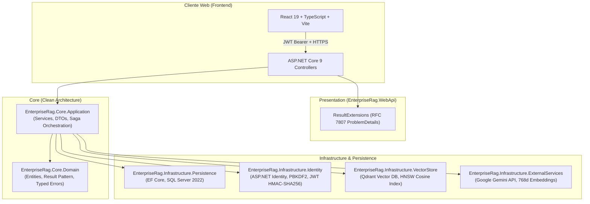

<div align="center">

# 🤖 Enterprise RAG System

### Plataforma Empresarial de Retrieval-Augmented Generation (RAG) & Asistente Corporativo Multitenant
*Clean Architecture · Aislamiento Multitenant Estricto · Búsqueda Semántica Vectorial con Qdrant · Web API en .NET 9 · SPA en React 19 + TypeScript + Vite + Tailwind CSS*

<br/>

[](https://dotnet.microsoft.com/)
[](https://learn.microsoft.com/dotnet/csharp/)
[](https://ai.google.dev/)
[](https://react.dev/)
[](https://www.typescriptlang.org/)
[](https://vitejs.dev/)
[](https://tailwindcss.com/)
[](https://blog.cleancoder.com/)
[](https://learn.microsoft.com/ef/core/)
[](https://www.microsoft.com/sql-server)
[](https://qdrant.tech/)
[](https://www.docker.com/)

</div>

---

## 📌 1. Descripción del Proyecto y Problema que Resuelve

Las organizaciones modernas manejan miles de documentos no estructurados (contratos, políticas operativas, manuales técnicos y normativas legales) dispersos en repositorios internos. Los modelos de lenguaje generales (LLMs) sufren de **alucinaciones** y desconocen la información privada corporativa.

**Enterprise RAG System** resuelve este desafío implementando una solución de arquitectura empresarial integral:
1. **Ingesta y Validación Rigurosa**: Validación binaria por *Magic Bytes* (previene subida de ejecutables camuflados) y extracción textual limpia.
2. **Chunking Semántico y Vectorización**: Fragmentación en chunks de 800 caracteres con solapamiento (*overlap*) de 100 caracteres, convertidos a vectores densos de 768 dimensiones mediante `gemini-embedding-001`.
3. **Indexación HNSW en Qdrant**: Búsqueda vectorial ultrarrápida por distancia coseno con filtrado estricto por `TenantId`.
4. **Síntesis Fundamentada con Google Gemini**: Generación de respuestas con citas exactas, referencias a fragmentos consultados y nivel de relevancia (*score*).
5. **Seguridad y Aislamiento B2B**: Garantía criptográfica y a nivel de datos de que ningún inquilino (*tenant*) pueda acceder a documentos o vectores ajenos.

---

## 🏛️ 2. Arquitectura del Sistema

El sistema sigue los principios de **Clean Architecture**, **Domain-Driven Design (DDD)** y el patrón funcional **Result Pattern**, desacoplando totalmente las reglas de negocio de la infraestructura.



---

## 🔄 3. Flujo RAG: Ingestión, Indexación y Recuperación

```mermaid
sequenceDiagram
    autonumber
    actor User as Usuario Autenticado
    participant Client as Frontend (React + Vite)
    participant WebApi as Web API (.NET 9)
    participant DocService as DocumentService (Saga)
    participant Gemini as Google Gemini API
    participant Qdrant as Qdrant Vector DB
    participant Sql as SQL Server 2022

    rect rgb(20, 25, 40)
    Note over User,Sql: Flujo de Ingestión Documental
    User->>Client: Sube archivo PDF
    Client->>WebApi: POST /api/v1/documents/upload (Multipart)
    WebApi->>DocService: UploadDocumentAsync(stream, tenantId)
    DocService->>DocService: Valida Magic Bytes (%PDF) y Cuota
    DocService->>DocService: Chunking (800 chars, overlap 100)
    DocService->>Gemini: Genera Embeddings (gemini-embedding-001, 768d)
    Gemini-->>DocService: Vectores 768d
    DocService->>Qdrant: Upsert Chunks con Payload { tenantId, documentId }
    DocService->>Sql: Guarda Documento y Chunks Metadata
    Note over DocService,Sql: Si SQL falla, se dispara Compensación: rollback en Qdrant y borrado de archivo físico
    DocService-->>WebApi: Result<DocumentItemDto>.Success
    WebApi-->>Client: 200 OK (Documento Indexado)
    end

    rect rgb(20, 35, 30)
    Note over User,Sql: Flujo de Consulta RAG (Chat / Búsqueda)
    User->>Client: "¿Cuál es la política de devoluciones?"
    Client->>WebApi: POST /api/v1/chat/ask { query }
    WebApi->>DocService: AskQuestionAsync(query, tenantId)
    DocService->>Gemini: Genera Embedding de la consulta (768d)
    Gemini-->>DocService: Vector de consulta
    DocService->>Qdrant: Search (Cosine, Filter: tenantId == JWT.tenantId, Top 5)
    Qdrant-->>DocService: Fragmentos más relevantes con score > 0.6
    DocService->>Gemini: Prompt Contextualizado (Contexto + Pregunta)
    Gemini-->>DocService: Respuesta fundamentada
    DocService-->>WebApi: Result<ChatResponseDto> (Respuesta + Citas reales)
    WebApi-->>Client: 200 OK con respuesta y fuentes consultadas
    end
```



---

## 🔒 4. Seguridad Multitenant & Protección de Datos

| Mecanismo | Implementación Técnica | Garantía de Seguridad |
|---|---|---|
| **Aislamiento Multitenant** | `TenantId` criptográfico (`Guid`) inyectado en Claims del JWT emitido. | El backend nunca confía en el `TenantId` enviado por el cuerpo del cliente en operaciones autenticadas. |
| **Protección en Registro** | Auto-aprovisionamiento con `Guid.NewGuid()` si no se suministra un Tenant. | Previene la auto-asignación a organizaciones ajenas sin invitación previa. |
| **Búsqueda Vectorial Aislada** | Filtros de Qdrant forzados con `FieldCondition("tenantId", MatchValue(tenantId))`. | Cero riesgo de que un inquilino recupere o consulte vectores de otro cliente. |
| **Validación de Archivos** | Inspección de primeros bytes (*Magic Bytes*: `%PDF-`, etc.). | Mitiga ataques de extension spoofing (ej. ejecutables `.exe` renombrados a `.pdf`). |
| **Resiliencia y Saga Compensatoria** | Patrón Saga en `DocumentService.UploadDocumentAsync()`. | Si la persistencia relacional falla, se compensa eliminando automáticamente los vectores de Qdrant y el archivo en disco. |
| **Zero Secrets in Git** | Exclusión de `.env`, `Storage/Uploads` y migración a .NET User Secrets. | Repositorio 100% libre de secretos, credenciales o documentos personales. |

---

## 🛠️ 5. Stack Tecnológico

* **Backend**: .NET 9.0 (C# 13), ASP.NET Core Web API, Entity Framework Core 9.
* **Inteligencia Artificial**: Google Gemini API (`gemini-2.5-flash`, `gemini-embedding-001` con `outputDimensionality: 768`).
* **Bases de Datos**:
  * **Relacional / Identity**: Microsoft SQL Server 2022 (Linux Container).
  * **Vectorial**: Qdrant Vector Database (Índices HNSW, Distancia Coseno).
* **Frontend**: React 19, TypeScript 5, Vite, Tailwind CSS v4, Lucide Icons.
* **Seguridad & Autenticación**: ASP.NET Core Identity, PBKDF2 Hashing, JWT Bearer (HMAC-SHA256 con claves ≥ 32 bytes), Account Lockout tras 5 intentos fallidos.
* **Infraestructura**: Docker & Docker Compose con healthchecks activos.
* **Testing**: xUnit, Moq, FluentAssertions (26/26 pruebas unitarias y de aislamiento multitenant pasando en verde).

---

## 🚀 6. Instalación y Puesta en Marcha Local

### Requisitos Previos
* [.NET 9.0 SDK](https://dotnet.microsoft.com/download/dotnet/9.0)
* [Node.js 20+](https://nodejs.org/) y npm
* [Docker Desktop](https://www.docker.com/products/docker-desktop/) en ejecución

### Paso 1: Clonar el Repositorio
```powershell
git clone https://github.com/Adrixn23/enterprise-rag-system.git
cd enterprise-rag-system
git checkout feature/rag-chat-module
```

### Paso 2: Configurar Infraestructura con Docker
Copia el archivo de entorno y levanta los servicios:
```powershell
Copy-Item .env.example .env
docker compose up -d sqlserver qdrant
```
* **SQL Server**: `localhost:1433`
* **Qdrant**: `localhost:6333` (Dashboard disponible en `http://localhost:6333/dashboard`)

### Paso 3: Configurar Secretos del Backend (.NET User Secrets)
```powershell
dotnet user-secrets init --project src/Presentation/EnterpriseRag.WebApi

dotnet user-secrets set "Gemini:ApiKey" "TU_API_KEY_DE_GEMINI" --project src/Presentation/EnterpriseRag.WebApi
dotnet user-secrets set "Gemini:Model" "gemini-2.5-flash" --project src/Presentation/EnterpriseRag.WebApi
dotnet user-secrets set "Gemini:EmbeddingModel" "gemini-embedding-001" --project src/Presentation/EnterpriseRag.WebApi

dotnet user-secrets set "ConnectionStrings:DefaultConnection" "Server=localhost,1433;Database=EnterpriseRagDb;User Id=sa;Password=YourStrong@Pass123!;TrustServerCertificate=True;MultipleActiveResultSets=true;" --project src/Presentation/EnterpriseRag.WebApi
dotnet user-secrets set "ConnectionStrings:IdentityConnection" "Server=localhost,1433;Database=EnterpriseRagIdentityDb;User Id=sa;Password=YourStrong@Pass123!;TrustServerCertificate=True;MultipleActiveResultSets=true;" --project src/Presentation/EnterpriseRag.WebApi

dotnet user-secrets set "JWTSettings:Key" "EnterpriseRag_SuperSecret_Key_For_JWT_Authentication_2026_Development_Key_123456789!" --project src/Presentation/EnterpriseRag.WebApi
```

### Paso 4: Ejecutar Migraciones de Base de Datos
```powershell
dotnet ef database update --project src/Infrastructure/EnterpriseRag.Infrastructure.Persistence --startup-project src/Presentation/EnterpriseRag.WebApi --context ApplicationDbContext
dotnet ef database update --project src/Infrastructure/EnterpriseRag.Infrastructure.Identity --startup-project src/Presentation/EnterpriseRag.WebApi --context IdentityContext
```

### Paso 5: Iniciar la API y el Frontend
En una terminal:
```powershell
dotnet run --project src/Presentation/EnterpriseRag.WebApi
```
*(API iniciada en `http://localhost:5235`)*

En otra terminal:
```powershell
cd client
npm install
npm run dev
```
*(Frontend disponible en `http://localhost:5173`)*

---

## 🧪 7. Pruebas Unitarias y Calidad

Para ejecutar la suite completa de pruebas unitarias y de aislamiento multitenant:
```powershell
dotnet test tests/EnterpriseRag.UnitTests/EnterpriseRag.UnitTests.csproj
```
Resultado verificado:
```text
Passed!  - Failed: 0, Passed: 26, Skipped: 0, Total: 26, Duration: 84 ms
```

---

## 📸 8. Guía de Capturas Recomendadas para LinkedIn / Portafolio

Para presentar este proyecto de forma atractiva en LinkedIn y reclutadores técnicos, se sugiere tomar las siguientes capturas:

1. **Dashboard de Documentos**: Mostrando la subida validada por Magic Bytes, tamaño de archivo y estado *Indexado en Qdrant*.
2. **Ventana de Chat RAG con Citas**: Pregunta corporativa compleja y respuesta sintetizada por Gemini, desplegando el cuadro desplegable de *Fuentes Consultadas (score % y snippet citado)*.
3. **Búsqueda Vectorial**: Vista de fragmentos recuperados con sus respectivos porcentajes de similitud coseno.
4. **Dashboard de Qdrant**: Captura del panel web (`http://localhost:6333/dashboard`) mostrando la colección `documents_chunks` con los vectores HNSW de 768 dimensiones.
5. **Suite de Tests en Consola**: Captura limpia de `dotnet test` mostrando los 26 tests en verde (destacando las pruebas de aislamiento multitenant y compensación Saga).

---

## 👤 Autor

* **Adrián Francisco Brito Nelkitts** - *Software Architect & Backend Engineer*
* GitHub: [@Adrixn23](https://github.com/Adrixn23)
* Repositorio: [Adrixn23/enterprise-rag-system](https://github.com/Adrixn23/enterprise-rag-system)
