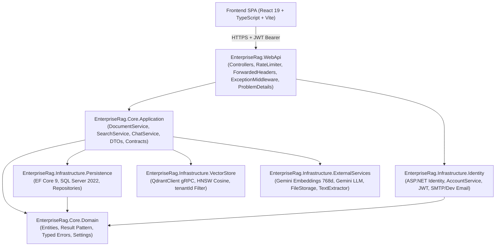

<div align="center">

# Enterprise RAG System

### Plataforma Empresarial de Retrieval-Augmented Generation (RAG) & Asistente Corporativo Multi-Tenant
*Clean Architecture · .NET 9 · C# 13 · SQL Server 2022 · Qdrant Vector DB · Google Gemini · React 19 + TypeScript + Vite*

<p>
  
  
  
  
  
  
  
</p>
<p>
  
  
  
  
  
</p>
<p>
  
  
  
  
  
</p>
<p>
  
  
  
  
  
</p>

</div>

---

## 1. Descripción del Proyecto

**Enterprise RAG System** es una aplicación full-stack empresarial diseñada para la ingesta segura, indexación vectorial y consulta conversacional de documentos corporativos mediante **Retrieval-Augmented Generation (RAG)**.

El sistema combina **ASP.NET Core 9** bajo **Clean Architecture**, **SQL Server 2022** para metadatos relacionales e identidad, **Qdrant** para búsqueda semántica por similitud coseno, **Google Gemini API** para embeddings de 768 dimensiones y síntesis de respuestas fundamentadas, y una SPA en **React 19 + TypeScript + Vite**.

---

## 2. Problema que Resuelve

Las organizaciones almacenan políticas, contratos y manuales en documentos no estructurados. Consultar un LLM público directamente produce alucinaciones, carece de citas verificables y expone información privada. Enterprise RAG System resuelve esto mediante:

- **Respuestas fundamentadas con citas reales:** cada respuesta del chat incluye los fragmentos recuperados y su puntuación de similitud.
- **Aislamiento estricto por organización (`TenantId`):** ningún inquilino puede consultar, listar, modificar ni eliminar documentos, chunks o vectores de otro tenant.
- **Ingesta validada:** verificación binaria por *Magic Bytes* y compensación tipo Saga ante fallos parciales entre Qdrant, SQL Server y almacenamiento en disco.

---

## 3. Características Principales Verificadas

- **Autenticación y Seguridad Identity:** registro aislado por tenant (`Guid.NewGuid()`), hashing PBKDF2, bloqueo tras 5 intentos fallidos, JWT HMAC-SHA256 (`ClockSkew = Zero`, clave ≥ 32 bytes validada al arranque).
- **Confirmación de Correo Segura (Production vs Development):** enlace con fragmento URL (`#token=...`) para no enviar el token en el `GET`, limpieza inmediata con `history.replaceState`, `Content-Security-Policy` con `nonce` criptográfico por petición, `Cache-Control: no-store`, `Referrer-Policy: no-referrer`, confirmación mediante `POST`, protección anti-enumeración y `EmailSettingsValidator` *fail-fast* en arranque.
- **Rate Limiting y Cooldown:** limitación por IP (`auth-register`, `auth-resend`, `auth-confirm`) con respuestas `429 Too Many Requests` (`ProblemDetails` + `Retry-After`) y cooldown por cuenta con bloqueo particionado en memoria.
- **Pipeline de Ingesta Documental:** validación de *Magic Bytes*, chunking configurable, batch embeddings (`gemini-embedding-001`, 768 dimensiones), indexación HNSW en Qdrant y rollback compensatorio si falla la persistencia en SQL Server.
- **Búsqueda Vectorial y Chat RAG:** recuperación semántica filtrada obligatoriamente por `tenantId` en Qdrant y enriquecida por lotes en SQL Server (sin consultas N+1).
- **Frontend Modular:** SPA en React 19 + TypeScript con componentes desacoplados (`AuthCard`, `DocumentsManager`, `SemanticSearch`, `RagChatWindow`), manejo global de sesiones `401` e historial de chat aislado por `userId` en `localStorage`.

---

## 4. Arquitectura del Sistema



Para detalles de capas, flujo Saga y manejo de cancelaciones, consulta [docs/ARCHITECTURE.md](docs/ARCHITECTURE.md).

---

## 5. Stack Tecnológico

- **Backend:** .NET 9.0, C# 13, ASP.NET Core Web API, Entity Framework Core 9, ASP.NET Core Identity, JWT Bearer (`HMAC-SHA256`), Polly (`Microsoft.Extensions.Http.Resilience`), Mapster, PdfPig, OpenAPI.
- **Bases de Datos:** Microsoft SQL Server 2022, Qdrant Vector Database (`Qdrant.Client` gRPC).
- **IA Generativa y Embeddings:** Google Gemini API (`gemini-embedding-001` con `outputDimensionality: 768`, `gemini-3.5-flash-lite`).
- **Frontend:** React 19, TypeScript, Vite 8, Tailwind CSS v4, Lucide React, Oxlint.
- **Infraestructura y Pruebas:** Docker, Docker Compose, GitHub Actions CI, xUnit, Moq, FluentAssertions, Microsoft.Playwright.

---

## 6. Estructura de Carpetas

```text
enterprise-rag-system/
├── client/                                      # SPA React 19 + TypeScript + Vite
├── docs/                                        # Documentación técnica (ARCHITECTURE, SECURITY, TESTING)
├── src/
│   ├── Core/
│   │   ├── EnterpriseRag.Core.Domain/           # Entidades, Result<T>, Errores tipados, Settings
│   │   └── EnterpriseRag.Core.Application/      # Servicios de aplicación, DTOs y contratos
│   ├── Infrastructure/
│   │   ├── EnterpriseRag.Infrastructure.Persistence/      # ApplicationDbContext, Repositorios EF Core
│   │   ├── EnterpriseRag.Infrastructure.Identity/         # IdentityContext, AccountService, SMTP/Dev Email
│   │   ├── EnterpriseRag.Infrastructure.VectorStore/      # QdrantVectorStoreService
│   │   └── EnterpriseRag.Infrastructure.ExternalServices/ # Gemini API, FileStorage, TextExtractor
│   ├── IoC/
│   │   └── EnterpriseRag.IoC/                   # Registro modular de dependencias y validadores
│   └── Presentation/
│       └── EnterpriseRag.WebApi/                # Controladores, Middlewares, RateLimiter, Program.cs
├── tests/
│   ├── EnterpriseRag.UnitTests/                 # Pruebas unitarias, Identity real y Playwright (118 tests)
│   └── EnterpriseRag.IntegrationTests/          # Pruebas reales SQL Server + Qdrant (7 tests)
├── Dockerfile                                   # Build multi-stage .NET 9
├── docker-compose.yml                           # Orquestación sqlserver, qdrant y api
└── .env.example                                 # Plantilla de variables de entorno sin secretos
```

---

## 7. Flujo RAG

1. **Ingesta:** `POST /api/v1/documents/upload` valida el archivo por *Magic Bytes*, guarda el archivo en almacenamiento local, extrae texto y lo divide en chunks.
2. **Embeddings:** `GeminiEmbeddingService` genera vectores de 768 dimensiones mediante `gemini-embedding-001`.
3. **Almacenamiento Dual + Saga:** `QdrantVectorStoreService.UpsertPointAsync` indexa los puntos con payload `{ tenantId, documentId, chunkIndex, content }`. Luego `DocumentRepository` persiste `Document` y `DocumentChunk` en SQL Server; si SQL falla, se eliminan los vectores en Qdrant y el archivo físico.
4. **Recuperación:** `SearchService` vectoriza la consulta y ejecuta `QdrantVectorStoreService.SearchAsync` con filtro obligatorio `tenantId`, filtrando por `MinScore` y resolviendo nombres en lote vía `DocumentRepository.GetFileNamesByIdsAsync`.
5. **Generación:** `ChatService` construye el prompt contextualizado y solicita la síntesis a `GeminiGenerativeAiService`, retornando respuesta y citas verificables.

---

## 8. Estrategia Multi-Tenant y Seguridad

- El `TenantId` se asigna en el servidor al registrar una organización (`Guid.NewGuid()`); los DTOs de registro y endpoints autenticados no aceptan `TenantId` arbitrario del cliente.
- Todos los controladores protegidos extraen `tenantId` exclusivamente del claim `"tenantId"` del JWT validado y devuelven `401 Unauthorized` si falta o es inválido.
- Qdrant filtra obligatoriamente por `tenantId` en búsqueda y por `tenantId` + `documentId` en eliminación.
- `DocumentRepository` y `DocumentChunkRepository` exigen `tenantId` en consultas, actualizaciones de estado y borrado lógico (`!IsDeleted`).

Consulta la matriz completa de controles en [docs/SECURITY.md](docs/SECURITY.md).

---

## 9. Ejecución Local con Docker Compose

### Requisitos
- [.NET 9.0 SDK](https://dotnet.microsoft.com/download/dotnet/9.0)
- [Node.js 20+](https://nodejs.org/)
- [Docker Desktop](https://www.docker.com/products/docker-desktop/)

### Paso 1: Variables de entorno
```powershell
Copy-Item .env.example .env
```
Edita `.env` con tus claves locales (`MSSQL_SA_PASSWORD`, `GeminiSettings__ApiKey`, `JWTSettings__Key`, y `EmailSettings__*` si ejecutas `api` en contenedor en modo `Production`).

### Paso 2: Levantar infraestructura (SQL Server y Qdrant)
```powershell
docker compose config
docker compose up -d sqlserver qdrant
```
- **SQL Server:** `localhost:1433`
- **Qdrant:** `localhost:6333` (HTTP/Dashboard) y `localhost:6334` (gRPC)

### Paso 3: Configurar User Secrets para ejecutar la WebApi en Development
```powershell
dotnet user-secrets init --project src/Presentation/EnterpriseRag.WebApi
dotnet user-secrets set "ConnectionStrings:DefaultConnection" "Server=localhost,1433;Database=EnterpriseRagDb;User Id=sa;Password=TU_PASSWORD_SQL;TrustServerCertificate=True;MultipleActiveResultSets=true;" --project src/Presentation/EnterpriseRag.WebApi
dotnet user-secrets set "ConnectionStrings:IdentityConnection" "Server=localhost,1433;Database=EnterpriseRagIdentityDb;User Id=sa;Password=TU_PASSWORD_SQL;TrustServerCertificate=True;MultipleActiveResultSets=true;" --project src/Presentation/EnterpriseRag.WebApi
dotnet user-secrets set "JWTSettings:Key" "TU_CLAVE_JWT_DE_AL_MENOS_32_BYTES_SEGUROS!" --project src/Presentation/EnterpriseRag.WebApi
dotnet user-secrets set "JWTSettings:Issuer" "EnterpriseRagApi" --project src/Presentation/EnterpriseRag.WebApi
dotnet user-secrets set "JWTSettings:Audience" "EnterpriseRagClient" --project src/Presentation/EnterpriseRag.WebApi
dotnet user-secrets set "GeminiSettings:ApiKey" "TU_GEMINI_API_KEY" --project src/Presentation/EnterpriseRag.WebApi
```

### Paso 4: Aplicar migraciones y ejecutar Backend + Frontend
```powershell
dotnet ef database update --project src/Infrastructure/EnterpriseRag.Infrastructure.Persistence --startup-project src/Presentation/EnterpriseRag.WebApi --context ApplicationDbContext
dotnet ef database update --project src/Infrastructure/EnterpriseRag.Infrastructure.Identity --startup-project src/Presentation/EnterpriseRag.WebApi --context IdentityContext

dotnet run --project src/Presentation/EnterpriseRag.WebApi
```
En otra terminal:
```powershell
cd client
npm install
npm run dev
```

---

## 10. Pruebas Unitarias y de Integración

```powershell
# Build completo de la solución
dotnet build EnterpriseRag.slnx

# Pruebas unitarias (incluye proveedores reales de Identity y pruebas Playwright)
dotnet test tests/EnterpriseRag.UnitTests/EnterpriseRag.UnitTests.csproj

# Pruebas de integración reales contra SQL Server y Qdrant (requiere Docker activo)
dotnet test tests/EnterpriseRag.IntegrationTests/EnterpriseRag.IntegrationTests.csproj

# Build del frontend
cd client && npm run build
```

Consulta el detalle de cobertura, requisitos de Playwright y aislamiento de bases de prueba en [docs/TESTING.md](docs/TESTING.md).

---

## 11. Endpoints Principales Verificados

| Método | Ruta | Auth | Descripción |
|---|---|---|---|
| `POST` | `/api/v1/auth/register` | Anónimo + Rate Limit | Crea usuario y nuevo tenant aislado |
| `POST` | `/api/v1/auth/login` | Anónimo | Autentica y emite JWT (`tenantId` en claims) |
| `GET` | `/api/v1/auth/confirm-email` | Anónimo | Página HTML segura (lee `#token=` y limpia URL; no muta estado) |
| `POST` | `/api/v1/auth/confirm-email` | Anónimo + Rate Limit | Confirma correo con `{ userId, token }` |
| `POST` | `/api/v1/auth/resend-confirmation` | Anónimo + Rate Limit | Reenvía enlace con cooldown y respuesta anti-enumeración |
| `POST` | `/api/v1/documents/upload` | Bearer JWT | Sube, valida *Magic Bytes*, vectoriza e indexa documento |
| `GET` | `/api/v1/documents` | Bearer JWT | Lista documentos del tenant autenticado |
| `GET` | `/api/v1/documents/{id}` | Bearer JWT | Obtiene detalle de documento del tenant |
| `GET` | `/api/v1/documents/{id}/chunks` | Bearer JWT | Obtiene chunks no eliminados del documento del tenant |
| `DELETE` | `/api/v1/documents/{id}` | Bearer JWT | Elimina vectores en Qdrant, chunks/documento en SQL y archivo |
| `POST` | `/api/v1/search` | Bearer JWT | Búsqueda semántica vectorial aislada por tenant |
| `POST` | `/api/v1/chat` | Bearer JWT | Consulta RAG con síntesis de Gemini y fuentes citadas |

---

## 12. Limitaciones Conocidas

1. **Rate limiting y cooldown en memoria local:** `AddRateLimiter` y `IMemoryCache` operan por instancia; un despliegue multi-réplica requiere almacén distribuido (p. ej. Redis) o limitación en API Gateway.
2. **JWT en `localStorage`:** El cliente SPA almacena el token en `localStorage`, lo que lo expone si ocurriera una vulnerabilidad XSS (mitigable migrando a cookies `HttpOnly; Secure; SameSite=Strict`).
3. **Historial de chat en cliente:** Las conversaciones no se persisten en SQL Server; se guardan por `userId` en `localStorage` del navegador.
4. **Proxies externos:** `UseForwardedHeaders` confía por defecto solo en loopback (`ForwardLimit = 1`); detrás de balanceadores externos deben registrarse `KnownProxies`/`KnownNetworks`.
5. **Provisioning multi-usuario por tenant:** Actualmente cada registro público crea su propio tenant aislado; aún no existe flujo de invitaciones para sumar usuarios a un tenant existente.

---

## 13. Roadmap Realista

- [ ] Flujo de invitaciones firmadas para incorporar múltiples usuarios a un mismo `TenantId`.
- [ ] Almacenamiento distribuido (Redis) para rate limiting y cooldown en despliegues horizontales.
- [ ] Migración de sesión del SPA a cookies `HttpOnly` con protección CSRF.
- [ ] Persistencia opcional de historial de conversaciones en SQL Server aislada por `TenantId` y `UserId`.
- [ ] Suite automatizada de pruebas de componentes frontend con Vitest y Testing Library.
